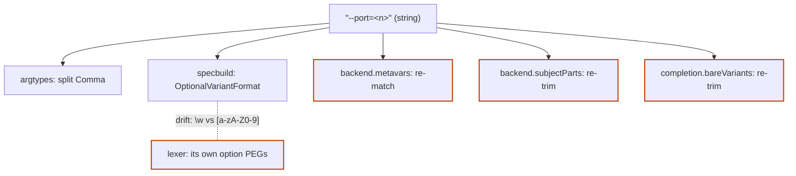
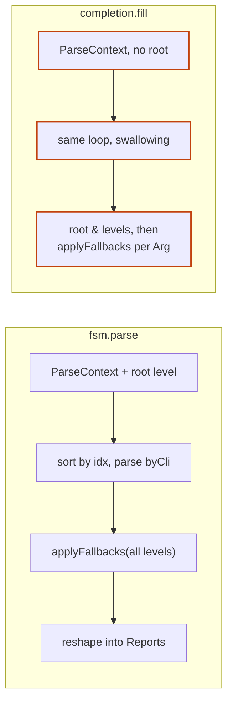

# Simplification review, 2026-10-14

The third architecture review, run after the Arg dispatch redesign (#246),
Message Arguments as a capability (#255) and `completion()` (#252) landed.
It continues the [pre-1.0 review](2026-09-24-pre-1-0-review.md)'s lettering
at P. Its focus is understandability and maintainability: places where one
rule is written in more than one module, and where a module's interface asks
more of its callers than it gives back.

Reviewed at `defdf39`. Vocabulary: domain terms per
[`GLOSSARY.md`](../../GLOSSARY.md); architecture terms (module, interface,
depth, seam, adapter, leverage, locality) as defined in the
`codebase-design` skill. Line numbers are as of the review date.

## Status

| | Candidate | Strength | Status |
|---|---|---|---|
| [P](#p--a-variant-module-one-grammar-parsed-once) | A Variant module: one grammar, parsed once | Strong | Shipped: #270, PR #276, `b694a67` |
| [Q](#q--committing-a-walk-lives-in-one-module) | Committing a walk lives in one module | Strong | Shipped: #260, PR #263, `c850052`; #261, PR #264, `8d79d44` |
| [R](#r--completion-owns-the-__complete-wire-format) | Completion owns the `__complete` wire format | Strong | Shipped: #266, PR #267, `43f6fd4` |
| [S](#s--the-help-frame-becomes-the-help-formatter-interface) | The help frame becomes the Help Formatter interface | Worth exploring | Shipped: #271, PR #278, `230e931`; ADR 0075 |
| [T](#t--arbitration-owns-the-whole-write-not-just-the-decision) | Arbitration owns the whole write, not just the decision | Worth exploring | Shipped: #272, PR #277, `3712f2a` |
| [U](#u--backendnim-sheds-the-completer-and-specsettings) | `backend.nim` sheds the Completer and `SpecSettings` | Worth exploring | Shipped with P: #270, PR #276, `b694a67` |
| [V](#v--the-facade-documents-each-parameter-once) | The facade documents each parameter once | Worth exploring | Shipped: #273, PR #279, `fa14e5a` |
| [W](#w--one-enum-for-value-precedence-tiers) | One enum for Value Precedence tiers | Speculative | Shipped: #274, PR #280, `4e826c2` |
| [X](#x--the-extender-surface-separates-from-the-user-surface) | The extender surface separates from the user surface | Worth exploring | Shipped: #269, PR #283, `2821cd2`; ADR 0076 |

**Recommendation:** Q first. It is the only candidate where the duplication
already carries a semantic split (`ParseContext.levels` means two things)
and a wrong doc comment, and it sits under the newest feature, runtime
Completers. It gives Value Precedence one home, makes R nearly free, and
gives the precedence tests a real entry point. P is the bigger
simplification overall; take it next.

Production lines, excluding `when isMainModule` test blocks:

| Module | Production | In-module tests |
|---|---|---|
| `argumint.nim` | 1,005 (539 doc) | 0 |
| `backend.nim` | 786 | 18 |
| `argtypes.nim` | 768 | 148 |
| `completion.nim` | 515 | 0 |
| `style.nim` | 426 | 302 |
| `complaints.nim` | 398 | 474 |
| `help.nim` | 342 | 1,072 |

## Candidates

### P — A Variant module: one grammar, parsed once

**Strong.** Files: `backend.nim:298–344`, `lexer.nim:38–57`,
`argtypes.nim:416, 692, 766`, `specbuild.addArg`, `backend.metavars`,
`backend.subjectParts`, `completion.bareVariants`,
`argumint.nim:642, 709, 724`.

**Problem.** The Variant grammar is written twice: five PEGs in `backend`
(`PositionalVariantFormat`, `OptionalVariantFormat`, `FlagVariantFormat`,
`FlagOpVariantFormat`, `UnknownFlagOpFormat`) and the lexer's own token
patterns. They have drifted. A short option is `{'-' \w}` in `backend` but
`{'-' [a-zA-Z0-9]}` in the lexer, so `flag("-_")` passes spec validation
and parses under an auto-filled usage, but a usage string naming `[-_]`
raises `SpecDefect: Undeclared command: -_` (verified by scratch compile).

`Arg.variants` also holds two forms: the declared string with its
placeholder for an `opt`/`opts` (`--port=<n>`), bare names for a Flag. So
the bare name or metavar is re-derived by `specbuild.addArg`,
`backend.metavars`, `backend.subjectParts` ("trim with the same PEG spec
construction already keys `spec.options` by") and `completion.bareVariants`,
whose doc spends ten lines on the asymmetry. Splitting on `Comma` is done
unvalidated in four places, and Flags are validated at construction while
value Args wait for `specbuild`.

**Solution.** One module owns the Variant grammar, parses each Variant once
at construction into its bare name, metavar and kind, and is shared with
the lexer. `Arg` stores parsed Variants; the re-deriving sites read fields.

**Wins.**

- Locality: one grammar, so no drift.
- Four or five re-parsing sites deleted.
- `backend` sheds its PEG cluster.
- One interface to test every spelling against.
- The Flag/value-Arg asymmetry disappears.

**As shipped.** Variants stay strings and aren't parsed once at
construction: `Arg` stores no parsed Variant, since a second record could
disagree with `variants`, which is public and writable (a gap
[X](#x--the-extender-surface-separates-from-the-user-surface) has since
closed).
Each site that needs a name or metavar calls `parseVariant` instead, and
`splitVariants` replaces every comma split. The grammar had a third copy
the card missed, `tokens.nim`'s runtime option shapes; the new leaf
`variant.nim` holds it as PEG source fragments that the lexer, `tokens`
and `parseVariant` all build from. Short options narrowed to
`-[a-zA-Z0-9]` everywhere, and command Variants gained a grammar, so
`command("BUILD")` or `command("-x")` now raises a `SpecDefect` when built.
The Flag Operation PEGs moved to `argtypes`, beside their one user, as
`FlagOpEntryFormat` and `UnknownFlagOpFormat`.

### Q — Committing a walk lives in one module

**Strong.** Files: `fsm.nim:80–103, 180–211`, `completion.nim:103–121,
227`, `matching.nim:47–51`, `precedence.applyFallbacks`,
`complaints.nim:386`.

**Problem.** What a successful walk writes into the Args (command-line
values in typed order, then env, then Config Source) is implemented twice.
`fsm.parse*` builds a `ParseContext` seeded with the root level, runs
`parseAllValues`, then `applyFallbacks` over every level, reshaping
failures into Reports. `completion`'s `Tab.fill` repeats the sort-and-parse
loop, swallowing failures, then calls `applyFallbacks` one Arg at a time
(`@[@[arg]]`) so it can swallow each one separately. Its context comes from
`frontierAfter`, which never seeds the root, so `fill` patches it back with
`@[tab.root] & pc.levels.mapIt(it.spec)`. `levels` therefore means
"root-first" on one path and "below the root" on the other, and
`matching.nim:48` says the completion path "neither seeds nor reads it",
though it reads it.

`fsm.parse*`'s `reshaped` template also builds a fresh Report per exception
kind, which is the only reason `Report.failure*` is exported.

**Solution.** One constructor, `initParseContext(spec, args, command)`,
that always seeds the root, and one commit step that owns "CLI tier in
typed order, then fallback tiers, failures shaped as Complaints", behind a
failure policy: `parse` raises, completion skips the failing Arg.

**Wins.**

- Locality: Value Precedence order written once.
- Runtime Completers see exactly what `parse` would store.
- `levels` has one meaning.
- `Report.failure` goes private.
- Precedence tests stop hand-building contexts.

**ADRs.** Keeps [ADR 0032](../adr/0032-parse-all-values-before-dispatch.md)
and [ADR 0071](../adr/0071-runtime-completers.md); only where their rule
lives changes.

### R — Completion owns the `__complete` wire format

**Strong.** Files: `fsm.nim:173–178`, `argumint.nim:813`,
`completion.nim:29, 89, 142, 317, 333`, `backend.Offer`, `help.nim:75`.

**Problem.** The reply the three shell scripts parse back is produced in two
modules: `fsm.parse*` writes the `value\thelp` lines, `completion.directive`
the final line. The `"__complete"` marker is checked in `fsm.nim` and again
in `isCompletionRequest*`, and `fsm` imports `completion` only for this.
Candidates have two types of the same shape, `CompletionCandidate` and
`Offer.values`, bridged by `valueCandidates`. The `[action: …]` annotation
is built by hand in `completion.nim:89` and separately by help's
annotation code, so the two can drift. `genCompletionScript` takes a `spec`
it doesn't use, "for call-site consistency".

**Solution.** `completion` owns the marker, `isCompletionRequest`, and one
`reply(spec, words, command): string`; `fsm.parse*` shrinks to a two-line
guard that raises it, and the facade wraps rather than re-checks. One
candidate type, in `backend`.

**Wins.**

- Locality: the wire format sits behind one seam.
- Tests assert the reply directly, not via `CompletionError`.
- `valueCandidates` deleted.

**As shipped.** `fsm` keeps its `completion` import, since its guard calls
`hasCompletionMarker` and `reply`. Help's annotation code isn't shared:
it's styled and covers more than the action, while completion shows the
action alone (ADR 0063), so the "agreement with help" suite in
`test_completion.nim` pins the two instead. The facade wraps the marker
check as `isCompletionRequest` rather than re-exporting it, so its doc
stays on the facade's page.

Not proposed: merging the three shell script templates. Each leans on its
own shell's mechanics (`COMP_WORDBREAKS`, `compset`, `commandline`), so
they aren't duplicates.

### S — The help frame becomes the Help Formatter interface

**Worth exploring.** Files: `help.nim:15–20, 149–158, 167, 212–250,
272–319`, `tests/test_help.nim:93–106`, `prose.nim:166`, `usage.nim:71`,
`console.nim:29–34`.

**Problem.** A formatter author faces about 32 names: 17 of `help`'s own
plus about 15 re-exported from `style`, `prose`, `usage` and `backend`.
Some add nothing: `ctx.heading` ignores `ctx`, `usageLines` is re-exported
beside `ctx.usage`, which wraps it, and `iterator groups*` only re-yields
the private `helpGroups`. Meanwhile the most useful piece, `frame` (prolog,
usage, groups, epilog), is private, so the one custom formatter in the repo
rebuilds it by hand with its own width floor and indents.
`formatColumn` and `formatParagraph` share `frame` but each repeat the
group loop.

The width floor of 20 is clamped in seven places with different meanings:
`frame` clamps but passes the raw width to `usageBlock`, which clamps again;
`renderParagraph`'s effective floors are 18 and 16; `console.nim`'s comment
cites "the floor the help renderers already clamp a width to".

**Solution.** Export the frame, parameterised by how a group's rows render,
so a formatter writes only "rows to text". Clamp the width once, when the
Help Context is built, with one named minimum. Drop the pass-through procs
and redundant re-exports.

**Wins.**

- Leverage: a custom formatter is about one row renderer.
- The toolkit's interface shrinks by about a third.
- One minimum width, one clamp.
- The built-ins stop duplicating the group loop.

**As shipped.** The Help Frame sits beside the Help Formatter rather than
becoming its interface: `ctx.frame(renderRows, form)` is public, and a
formatter may build on it or still write the whole message, so ADR 0048
stands ([ADR 0075](../adr/0075-help-formatters-build-on-the-help-frame.md)).
The clamp went into the `SpecSettings.width` getter, not the Help Context,
since parse errors never build one; `MinWidth` (20) names the minimum.

**ADRs.** Extends [ADR 0048](../adr/0048-pluggable-help-formatters.md) and
[ADR 0057](../adr/0057-help-context.md) rather than contradicting them, but
changes what the 1.0 Help Formatter toolkit freezes.

### T — Arbitration owns the whole write, not just the decision

**Worth exploring.** Files: `backend.nim:612–648`, `argtypes.nim:302–307,
620–628`.

**Problem.** `arbitration`'s own doc says "restating the rule by hand is
how a write silently demotes", yet the arbitrate, store, promote skeleton
is restated in three places: `Arg.parse`, `putImpl` for a value Arg, and
`putImpl` for a `FlagArg`. The Flag copy promotes `seenBy` before storing,
the reverse of `parse`'s order. It can't fail today, since nothing in it
raises, but the ordering rule isn't anywhere a reader would find it.

**Solution.** One template that arbitrates, runs the caller's store body,
and promotes `seenBy`.

**Wins.**

- Locality: promotion order fixed in one place.
- Small and mechanical.

**As shipped.** The template is `arbitrated`, and `arbitration` went
private behind it. "It can't fail today" was wrong: the order matters,
because a replacing store calls `clear`, which resets `seenBy`, so
promoting first would be undone. The Flag `putImpl` now stores before
promoting, like the others.

**ADRs.** Enacts [ADR 0041](../adr/0041-parse-is-the-write-surface.md) and
[ADR 0044](../adr/0044-put-typed-write-accessor.md) more strictly.

### U — `backend.nim` sheds the Completer and `SpecSettings`

**Worth exploring.** Files: `backend.nim:39–88, 151–172, 346–391,
412–503`.

**Problem.** `backend` is 786 production lines, the growth the
[first map](2026-08-28-deepening-map.md#f--backendnim-holds-two-unrelated-data-models)
set as the condition for revisiting it. Besides the Arg/Spec domain model
it now holds the completion model (`PathCompletion`, `CompletionContext`,
`Offer`, `CompleterProc`, `Completer`, `initOffer` through `run`, about 95
lines) and `SpecSettings` with `newSpecSettings` (about 110 lines, mostly
doc), which pulls `console` and `style` into the domain model.

**Solution.** Move the two clusters to leaf modules below `backend`
(`Arg.complete` needs the Completer type, so it can't sit above). With P,
the PEGs leave too. The State/Transition/Matcher graph types stay: they are
about 35 lines and haven't grown, so F stays parked.

**Wins.**

- `backend` shrinks to its domain model.
- Dependency edges say what depends on terminal probing.

Close to a move rather than a deepening: the deletion test is weak. Best
done riding along with P.

**As shipped.** With P, as its own commit: `completer.nim` (a leaf) and
`settings.nim` (below `backend`). The dependency-edge win didn't hold.
`Spec` has a `settings` field and `Arg` a `complete` field, so `backend`
imports and re-exports both modules, and everything importing `backend`
still reaches `console` through `settings`. The gain is reading locality:
`backend` went from 793 production lines to about 510.

### V — The facade documents each parameter once

**Worth exploring.** Files: `argumint.nim:283–481, 588–696, 784–786,
848–982`, `argtypes.initValueArg`, `specbuild.newSpec`.

**Problem.** 539 of `argumint.nim`'s 1,005 lines are doc comments, much of
it the same parameter bullets copied four or five times: `validator` and
`complete` across `arg`/`args`/`opt`/`opts`, about 40 lines across the two
`command` overloads, and about 25 across each of `parse`, `parseOrQuit`,
`parsed`, `parsedOrQuit` and `newSpec`. They drift. Every constructor sets
`result.complete` after `initValueArg`, which has no `complete` parameter
and no defaults, which is also why `completion()` passes
`group = "", hidden = false`.

**Solution.** Give `initValueArg`/`initValuesArg` defaults and a `complete`
parameter. Route the four entry points through one private runner. Document
each parameter on one canonical overload and point the others at it.

**Wins.**

- Locality: one doc per parameter.
- `completion()` and future built-ins stop passing filler.

**As shipped.** The private runner was already in place, as
`buildAndBind`. `arg[T]`, `opt[T]`, `command[S]` and `parse*(tuple)` carry
each parameter's doc, and the other overloads say "as on" one of them. The
drift fixed: the `command` overloads said `config` for `settings`, the
`settings` bullets listed fields, and `flag[T]` didn't document `help`.
`argumint.nim` went from 1,007 lines to about 900.

**ADRs.** Nim forces the bare-call overloads and repeated signatures
([ADR 0061](../adr/0061-cmd-and-bare-calls.md)), so the gain is docs and
behaviour drift, not signatures. Public names stay in `argumint.nim` for the
API reference page.

### W — One enum for Value Precedence tiers

**Speculative.** Files: `backend.SeenBy`, `precedence.nim:16–20, 64–67`,
`tests/test_argumint.nim:75–99`.

**Problem.** `SeenBy` orders tiers weakest-first; `FallbackTier`
(`ftEnv, ftConfig`) orders the two fallback tiers strongest-first, and a
hand-written `case` maps one to the other. `FallbackTier` is exported only
for tests.

**Solution.** Drop `FallbackTier` and iterate
`const FallbackTiers = [byEnv, byConfig]`.

**Wins.**

- One name per tier.
- One exported name fewer.

**As shipped.** `FallbackTier` stayed, as `range[byConfig..byEnv]`, since
it still indexes the cursor array without unused slots. So each tier has
one name, but the module exports two names (`FallbackTier`, and
`FallbackOrder` for the strongest-first order), not one fewer. Iterating
the subrange itself runs weakest first, so both loops iterate
`FallbackOrder`. Comparing a `SeenBy` with a `FallbackTier` converts the
enum down to the subrange, which raises `RangeDefect` for `byCli`; that
trap is in `docs/gotchas.md`.

### X — The extender surface separates from the user surface

**Worth exploring.** Found while grilling P; filed as #269, which needs its
own grilling. Files: `backend.Arg`, `argtypes.initValueArg`,
`backend.arbitrated`, `tests/test_write_side.nim`,
[ADR 0017](../adr/0017-argumint-reexports-for-custom-arg-types.md),
[ADR 0030](../adr/0030-core-types-exported-spec-opaque.md),
[ADR 0043](../adr/0043-facade-machinery-seam.md).

**Problem.** `import argumint` gives every caller write access to all of
`Arg`'s public fields (`kind`, `variants`, `help`, `group`, `hidden`,
`complete`, `seenBy`, plus `CommandArg.spec` and `MessageArg.message`). A
CLI author needs at most to read a few. Only an
extender building a custom `Arg` subtype needs to set them, and ADR 0030
lets them do it with `import argumint` alone. The sharpest case is
`variants`: it's checked when the Spec is built, but nothing stops a
caller changing it afterwards, leaving `spec.options`, `spec.arguments`,
the Flag ops table
and the FSM keyed by the old strings. Making the field private with a
withheld setter was prototyped during P's grilling, and broke ADR 0030's
custom-`Arg` contract.

**Solution.** A separate module for extenders (working name
`argumint/argbuilder`): `import argumint` exposes Args read-only, and the
extender module adds what a custom `Arg` needs to build and write one.
Open questions include which fields an extender may set, and whether
`initValueArg` (with V's signature) and `arbitrated` (from T) move there.

**Wins.**

- `variants` can't drift from the Spec built on it, so `parseVariant`'s
  raw-string fallbacks in `backend.metavars` and `backend.subjectParts`
  become assertions.
- The user surface shrinks to reads.

**ADRs.** Revisits [ADR 0030](../adr/0030-core-types-exported-spec-opaque.md)'s
custom-`Arg` contract, and may give
[ADR 0043](../adr/0043-facade-machinery-seam.md)'s seam a third tier.

**As shipped.** The module is `argumint/customarg`, named for the
glossary's Custom Arg, and it is an opt-in public module like
`argumint/help` rather than a third tier of ADR 0043's seam. Only the four
fields a Spec is built from became read-only (`kind`, `variants`, `seenBy`
and `CommandArg.spec`); the presentation fields stay public, since writing
one corrupts nothing. A Custom Arg sets its kind and Variants once with
`initArg`, and the nine names only it needs moved out of the facade.
`initValueArg` and `arbitrated` stay withheld, deferred until a Custom Arg
needs them. The first win is withdrawn: the fallbacks in `metavars` and
`subjectParts` also handle every Positional and Command, whose Variant
isn't option-shaped, so they stay. See
[ADR 0076](../adr/0076-custom-args-build-through-customarg.md).

## Smaller findings

Not candidates, but worth a cleanup pass:

- `dot*(State, proc)` has no callers (29 of `dot.nim`'s 73 lines), and
  `dot*(tuple)` still calls `quit` though its name doesn't end in `OrQuit`.
- `fsm.nim` imports `parser` and `configsource` without using them and
  re-exports error types the facade already exports. `validators.nim`
  imports `lexer` only for `SpecDefect`, which `errors` gives it; `lexer`
  and `parser` re-export `SpecDefect`.
- Doc drift: `docs/architecture.md` says completion takes its own
  `privateAccess(Spec)` (it doesn't); `matching.nim:70–72` says a Command
  push's idx is `0` (it's `pc.cursor[0].idx`); `complaints.nim`'s header
  says `walk` records into a Report (mostly `match` does); `tokens.nim:150`
  names `fsm.nim` as the caller of `len`/`[]`.
- `help.variantsColWidth` counts hidden Args, so a hidden one widens the
  visible column, the same family as a hidden command appearing in
  auto-filled usage lines.
- `ValueArgBase` and `FlagArgBase` duplicate the `env` and config-key
  fields, `envSource`, `configKey` and `clear`; the field is `cfgKey`, the
  method and public parameter `configKey`.
- `tests/test_argumint.nim` is 2,750 lines, up from 2,277. Its fallback-tier
  block (about 670 lines) maps straight onto `precedence`, `envvar` and
  `configsource`.
- `style.nim` mixes spans, Theme, a forked `wrapWords` and the Help Markup
  classifier. Markup could sit with Prose. Low payoff.
